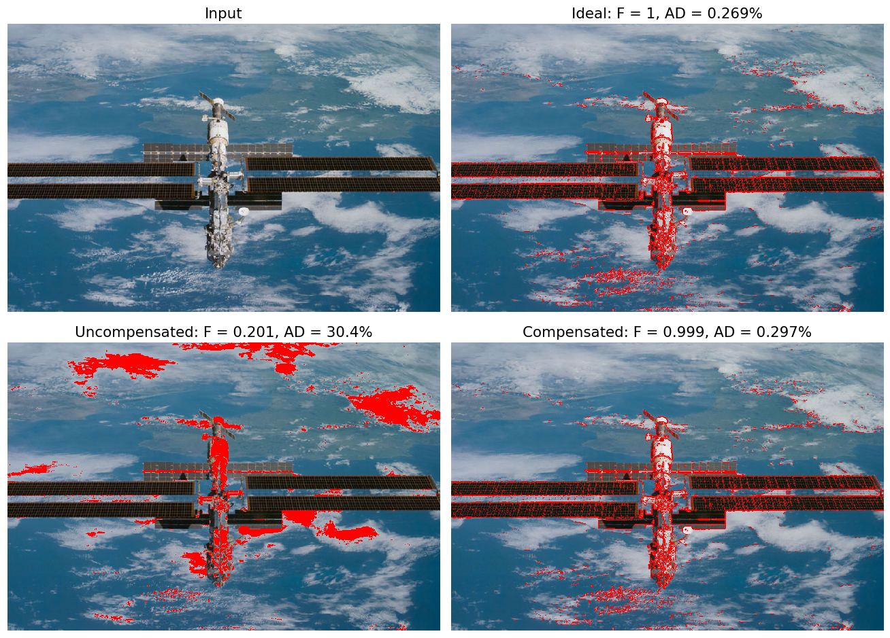
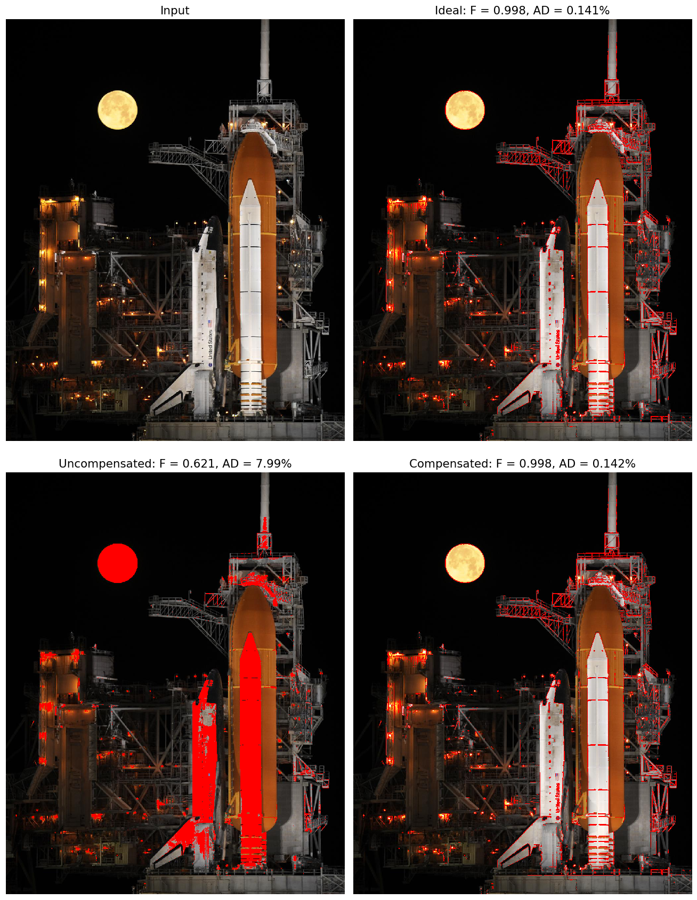
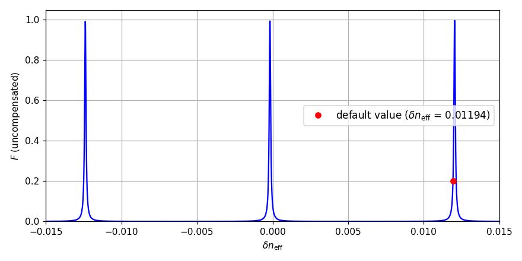

# MZI-Based Optical Differentiator for Edge Detection

Simulation of an **optical temporal differentiator** based on an unbalanced silicon **Mach–Zehnder interferometer (MZI)**, applied to **edge detection** in images.
The simulation includes fabrication tolerances and laser frequency fluctuations, the **thermal compensation** of the fabrication errors, and evaluates the quality of the differentiation with dedicated figures of merit.



*Edges (in red) detected by the simulated device on a photo of the International Space Station. Without compensation, fabrication errors move the zero of the transfer function away from the carrier: the MZI no longer differentiates the signal, so bright areas (the clouds and the modules of the station) are filled instead of outlined. Thermal compensation restores a response almost identical to the ideal one.*

## How it works

1. **Serialization**: the image is converted to gray scale and each row is read as a waveform, one pixel every $1/f_s$, that modulates the amplitude of an optical carrier at $f_c = 193$ THz ($\lambda \approx 1.55$ µm).
2. **Differentiation**: the field passes through the MZI. Its transfer function

   $$H_\mathrm{MZI}(f) = j\, e^{-j\Delta\varphi(f)/2} \sin\!\left(\frac{\Delta\varphi(f)}{2}\right), \qquad \Delta\varphi(f) = \frac{2\pi f}{c}\, n_\mathrm{eff}\, \Delta L$$

   is approximately linear around each of its zeros. If the carrier sits on a zero, the MZI behaves as an ideal differentiator $H_\mathrm{id}(f) \propto j\,(f - f_c)$ and the output is the time derivative of the input envelope.
3. **Edge detection**: the output intensity is high where the brightness changes abruptly. Pixels above an adaptive threshold ($\mu + 1.7\,\sigma$ of the output) are marked as edges. The same procedure is repeated on the columns (transposed image), and both results are overlaid in red on the original image.

### Device design

| Parameter | Value |
|---|---|
| Carrier frequency $f_c$ | 193 THz, tolerance $\delta f_c = 0.1$ GHz |
| Effective index $n_\mathrm{eff}$ | 2.2, maximum tolerance $\delta n_\mathrm{eff} = 0.012$ (450 nm × 220 nm silicon waveguide), simulated error $+0.01194$ by default |
| Path difference $\Delta L_\mathrm{id} = m\,c / (n_\mathrm{eff}\, f_c)$ | $m = 180$, $\Delta L_\mathrm{id} \approx 127$ µm, tolerance 10 nm |
| Free spectral range | ≈ 1.07 THz |
| Sampling frequency $f_s$ | 100 GHz |
| Thermo-optic coefficient $K_\mathrm{th}$ | $1.86 \times 10^{-4}$ K⁻¹ |

### Design choices

**Carrier and waveguide.** The carrier is in the telecom C-band (1.55 µm), with a frequency stability of 0.1 GHz. The waveguide is a standard 450 nm × 220 nm silicon wire with $n_\mathrm{eff} = 2.2$ at 20 °C. Typical fabrication variations of width and thickness of a few nanometres give errors on $n_\mathrm{eff}$ of the order of $10^{-2}$; $0.012$ is used as reference tolerance.

**Path difference.** $\Delta L_\mathrm{id} = m\,c/(n_\mathrm{eff}\, f_c)$ makes the carrier coincide with the $m$-th zero of the ideal MZI, so $m$ is the only free parameter. A fabrication error shifts the zero by $\Delta m \approx m\,\delta n_\mathrm{eff}/n_\mathrm{eff}$ periods, which favours a small $m$; on the other hand, the relative error on $\Delta L$ must be negligible with respect to the one on $n_\mathrm{eff}$, which requires $\Delta L \gtrsim 100$ µm, i.e. $m \gtrsim 140$. Even with the best choice the uncompensated device is unreliable (see [Results](#effect-of-the-fabrication-error-on-the-effective-index)), so the final value of $m$ is set by the thermal compensation.

**Thermal compensation.** Heaters can only **increase** the temperature, and therefore $n_\mathrm{eff}$ (by $K_\mathrm{th}\,\Delta T$), which shifts the zeros towards lower frequencies. A negative error is compensated by moving the $m$-th zero back onto the carrier, a positive one by moving the $(m+1)$-th zero onto it. The target zero is therefore chosen from the sign of the error only: since the zero is shifted by less than one period (see below), this is always the nearest zero that can be reached by heating, except in the corner cases listed in [Known limitations](#known-limitations). Neglecting the error on $\Delta L$, the required temperature change is

$$\Delta T = \frac{1}{K_\mathrm{th}} \left( \frac{\delta m_T\, n_\mathrm{eff,id}}{m} - \delta n_\mathrm{eff} \right), \qquad \delta m_T = \begin{cases} 0 & \delta n_\mathrm{eff} < 0 \\ 1 & \delta n_\mathrm{eff} > 0 \end{cases}$$

The worst case ($\delta n_\mathrm{eff} \to 0^+$) gives $\Delta T_\mathrm{max} = n_\mathrm{eff,id}/(m\,K_\mathrm{th})$, which decreases with $m$. The largest $m$ for which the maximum error shifts the zero by less than one period is $m < n_\mathrm{eff}/\delta n_\mathrm{eff} \approx 183$, or $m < 181$ including the error on $\Delta L$: hence $m = 180$ and $\Delta T_\mathrm{max} \approx 65$ °C.

**Sampling frequency.** The signal bandwidth $B$ grows with $f_s$. It must stay inside the linear region of the device ($B/\mathrm{DOB} < 1$), but it must also be much wider than the residual detuning of the zero ($B/\delta f \gg 1$), otherwise the signal sees a transfer function very different from the ideal one. With $f_s = 100$ GHz the default image has $B \approx 16$ GHz, $B/\mathrm{DOB} \approx 0.16$ and, after compensation, $B/\delta f \approx 160$.

**Tolerance analysis.** The quality factor $Q = f_c/\mathrm{DOB} \approx 1.9 \times 10^3$ estimates the error on each parameter that shifts the zero by one DOB, taking one parameter at a time:

| Parameter | Maximum error |
|---|---|
| $\Delta L$ | ≈ 65 nm |
| $n_\mathrm{eff}$ | ≈ $1.1 \times 10^{-3}$ |
| waveguide width | ≈ 0.38 nm |
| waveguide thickness | ≈ 0.27 nm |
| temperature | ≈ 6 °C |

The tolerances on $\Delta L$ and temperature are achievable, but sub-nanometre control of the waveguide geometry is not, and the expected error on $n_\mathrm{eff}$ is ten times larger than the tolerable one: this is why the thermal compensation is needed.

### Figures of merit and performance metrics

- **DOB** (device operation bandwidth): width of the band around $f_c$ in which $|H_\mathrm{MZI}|$ deviates from $|H_\mathrm{id}|$ by at most 1%.
- **$B/\mathrm{DOB}$**: must be below 1, otherwise the signal bandwidth $B$ exceeds the linear region of the device.
- **$B/\delta f$**: ratio between the signal bandwidth and the detuning $\delta f$ of the nearest zero from the carrier; if it is too small, the signal "sees" a transfer function very different from the ideal one.
- **Quality factor** $Q = f_c / \mathrm{DOB}$: gives the order of magnitude of the maximum tolerable errors on $\Delta L$, $n_\mathrm{eff}$, waveguide width and thickness, and temperature.
- **Average deviation** $\mathrm{AD} = \frac{1}{T}\int_T |P(t) - P_\mathrm{id}(t)|\,dt$, computed on normalized output intensities over each row (uniform rows, which have no edges, are excluded).
- **Fidelity** $F$: normalized overlap integral between $H_\mathrm{MZI}$ and $H_\mathrm{id}$ over the signal band $[f_c - B/2,\ f_c + B/2]$.

## Installation

Tested with Python 3.12, both with NumPy 1.26, SciPy 1.13, Matplotlib 3.9, Pillow 10.4 and with NumPy 2.5, SciPy 1.18, Matplotlib 3.11, Pillow 13.0.

```bash
git clone https://github.com/marcovanzetto/mzi-edge-detection.git
cd mzi-edge-detection
pip install -r requirements.txt
```

## Usage

```bash
python src/mzi_edge_detection.py                          # uses images/iss.jpg
python src/mzi_edge_detection.py images/shuttle_moon.jpg   # or any other image
```

The script prints the circuit parameters, the maximum tolerable errors, the figures of merit and the performance metrics, then shows the image with the detected edges.

```bash
python src/fidelity_vs_error.py                       # fidelity vs error on n_eff (takes a few minutes)
```

This second script computes the fidelity of the uncompensated device for random errors on $n_\mathrm{eff}$ and saves the plot in `results/fidelity_vs_error.png`.

The options at the top of [`src/mzi_edge_detection.py`](src/mzi_edge_detection.py) select the simulated scenario:

| Option | Default | Effect |
|---|---|---|
| `is_image_plot` | `True` | shows the final image with highlighted edges |
| `is_control_plots` | `False` | shows input/output waveforms and spectra for one row |
| `is_compensated` | `True` | applies the thermal compensation |
| `is_ideal` | `False` | removes all fabrication and laser tolerances |
| `dn_eff_err` | `0.01194` | fabrication error on $n_\mathrm{eff}$ (physical parameters section) |

## Results

Results on the test images in [`images/`](images/) with the default error $\delta n_\mathrm{eff} = +0.01194$ and maximum tolerances on $\Delta L$ and $f_c$:

| Image | Ideal (F, AD) | Uncompensated (F, AD) | Compensated (F, AD) |
|---|---|---|---|
| `iss.jpg` | 1, 0.27% | 0.201, 30.4% | 0.999, 0.30% |
| `shuttle_moon.jpg` | 0.998, 0.14% | 0.621, 7.99% | 0.998, 0.14% |



*Without compensation the Moon and the shuttle are filled instead of outlined.*

The uncompensated fidelity depends on the image, because the signal bandwidth $B$ does: the more detailed photo of the shuttle has a wider bandwidth, which covers the detuning of the zero better, so its fidelity stays higher even though the edge map is clearly degraded.

### Effect of the fabrication error on the effective index

Results on `iss.jpg` for different values of `dn_eff_err`. $|\Delta m|$ is the shift of the $m$-th zero from the carrier in units of FSR, before compensation.

| $\delta n_\mathrm{eff}$ | $\lvert\Delta m\rvert$ | Uncompensated (F, AD) | Compensated (F, AD) | $\Delta T$ applied |
|---|---|---|---|---|
| −0.012 | 0.97 | 0.018, 32.3% | 0.999, 0.30% | 63.6 °C |
| −0.006 | 0.48 | 0.00019, 32.4% | 0.999, 0.30% | 31.3 °C |
| +0.003 | 0.26 | 0.00036, 32.4% | 0.999, 0.30% | 48.6 °C |
| +0.006 | 0.51 | 0.00019, 32.4% | 0.999, 0.30% | 32.5 °C |
| +0.0114 | 0.95 | 0.0069, 32.3% | 0.999, 0.30% | 3.5 °C |
| +0.01194 | 0.991 | 0.201, 30.4% | 0.999, 0.30% | 0.6 °C |
| +0.012 | 0.996 | 0.565, 19.6% | 0.999, 0.30% | 0.3 °C |
| +0.01205 | 1.0002 | 0.997, 0.51% | 0.999, 0.30% | ≈ 0 °C |

With compensation the result is the same for every error, with $\Delta T$ always below $\Delta T_\mathrm{max} \approx 65$ °C. Without compensation the fidelity is high only when a zero of the transfer function falls within a few GHz of the carrier:



*Fidelity of the uncompensated device on `iss.jpg` as a function of the error on $n_\mathrm{eff}$, computed with [`src/fidelity_vs_error.py`](src/fidelity_vs_error.py).*

$F$ is periodic in $\delta n_\mathrm{eff}$, with period $n_\mathrm{eff,id}/m \approx 0.0122$, and it exceeds 0.1 only in narrow windows about $3 \times 10^{-4}$ wide, around the errors that align a zero exactly with the carrier ($-0.00017$ and $+0.01205$ for these parameters): near these points, 1 GHz of detuning corresponds to a change of only $\approx 10^{-5}$ in $n_\mathrm{eff}$. The period is close to the reference tolerance because of the design rule $m < n_\mathrm{eff}/\delta n_\mathrm{eff}$, so the maximum error always brings the next zero close to the carrier. The default value $+0.01194$ lies on the side of one of these peaks: it leaves the nearest zero about 9 GHz from the carrier, which gives $F \approx 0.2$ on `iss.jpg` and $F \approx 0.6$ on `shuttle_moon.jpg`.

For random errors, drawn uniformly in different ranges (20 000 values for each range, errors on $\Delta L$ and $f_c$ at their maximum values):

| Range of $\delta n_\mathrm{eff}$ | Median $F$ | $F > 0.1$ | $F > 0.9$ |
|---|---|---|---|
| ±0.0005 | 0.043 | 31.9% | 3.5% |
| ±0.001 | 0.011 | 16.4% | 1.7% |
| ±0.003 | 0.0013 | 5.3% | 0.6% |
| ±0.006 | 0.00039 | 2.9% | 0.3% |
| ±0.012 | 0.00037 | 1.9% | 0.1% |
| ±0.024 | 0.00037 | 1.9% | 0.2% |

For errors of the order of the tolerance (any range wider than about half a period) the uncompensated device works only in a few percent of the cases. For errors below ≈ $5 \times 10^{-4}$ it works, at least partially, in a significant fraction of the cases (about one third for ±0.0005), consistently with the tolerance estimated from the quality factor.

## Known limitations

- The target zero of the compensation ($m$ or $m+1$) is chosen only from the sign of the error on $n_\mathrm{eff}$, without considering the error on $\Delta L$. In two narrow ranges, $-0.00017 < \delta n_\mathrm{eff} \le 0$ (where the error on $\Delta L$ prevails) and $\delta n_\mathrm{eff} > +0.01205$, just outside the tolerance range (where the zero is shifted by more than one FSR), the computed $\Delta T$ is negative (down to ≈ −0.9 °C in the first range), which heaters cannot provide. In all the other cases the chosen zero is the nearest one reachable by heating.
- The MZI model assumes ideal 50:50 couplers and lossless waveguides, so its zeros are perfect. It also neglects dispersion: $n_\mathrm{eff}$ is taken as frequency independent, while in a real silicon waveguide the phase slope and the FSR are set by the group index ($n_g \approx 4.2$ for a 450 nm × 220 nm wire), which would roughly halve the FSR for the same $\Delta L$.

## Repository structure

```
mzi-edge-detection/
├── src/
│   ├── mzi_edge_detection.py   # simulation and edge detection
│   └── fidelity_vs_error.py    # fidelity of the uncompensated device vs error on n_eff
├── images/                     # public test images (see images/CREDITS.md)
├── results/                    # example outputs
├── requirements.txt
└── LICENSE
```

## Authors

**Marco Vanzetto** and **Mattia Aldighieri**. Developed as a project for the Photonic Computing course, Master's degree, Politecnico di Milano, A.Y. 2025-26.

## References

- J. Dong, A. Zheng, D. Gao, L. Lei, D. Huang and X. Zhang, "Compact, flexible and versatile photonic differentiator using silicon Mach-Zehnder interferometers", *Optics Express* **21**, 7014–7024 (2013). [doi:10.1364/OE.21.007014](https://doi.org/10.1364/OE.21.007014)
- J. Dong et al., "Arbitrary-Order Bandwidth-Tunable Temporal Differentiator Using a Programmable Optical Pulse Shaper", *IEEE Photonics Journal* **3**, 996–1003 (2011). [doi:10.1109/JPHOT.2011.2170965](https://doi.org/10.1109/JPHOT.2011.2170965)
- R. Slavík, Y. Park, M. Kulishov, R. Morandotti and J. Azaña, "Ultrafast all-optical differentiators", *Optics Express* **14**, 10699–10707 (2006). [doi:10.1364/OE.14.010699](https://doi.org/10.1364/OE.14.010699)
- R. Ashrafi and J. Azaña, "Figure of merit for photonic differentiators", *Optics Express* **20**, 2626–2639 (2012). [doi:10.1364/OE.20.002626](https://doi.org/10.1364/OE.20.002626)
- S. K. Selvaraja, W. Bogaerts, P. Dumon, D. Van Thourhout and R. Baets, "Subnanometer Linewidth Uniformity in Silicon Nanophotonic Waveguide Devices Using CMOS Fabrication Technology", *IEEE Journal of Selected Topics in Quantum Electronics* **16**, 316–324 (2010). [doi:10.1109/JSTQE.2009.2026550](https://doi.org/10.1109/JSTQE.2009.2026550)

## License

The code is released under the [MIT License](LICENSE). The test images have their own licenses, listed in [`images/CREDITS.md`](images/CREDITS.md).
